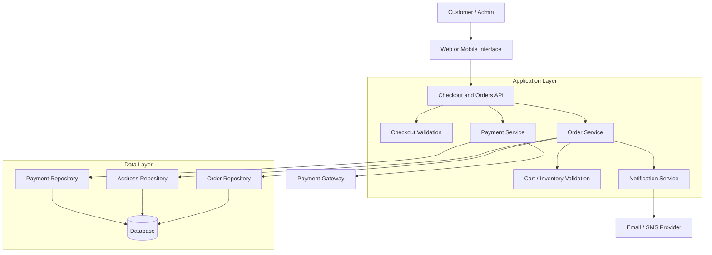
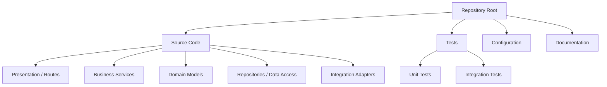
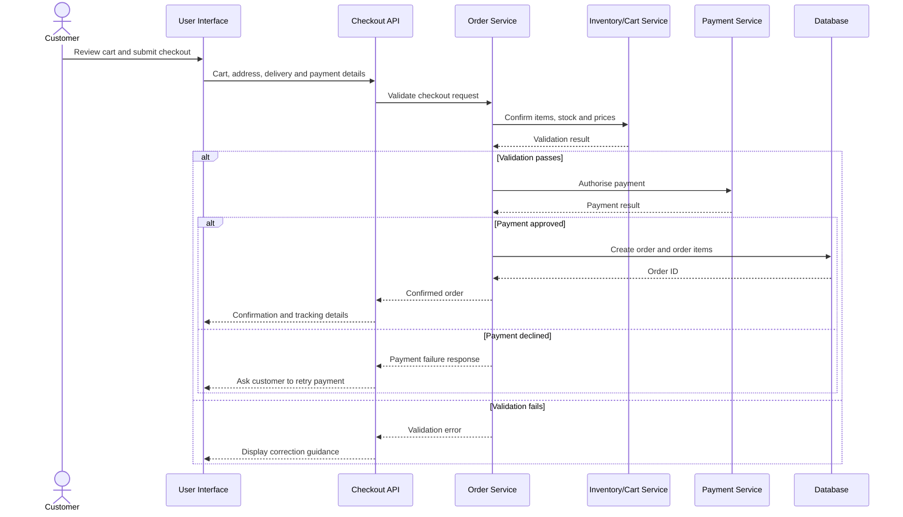
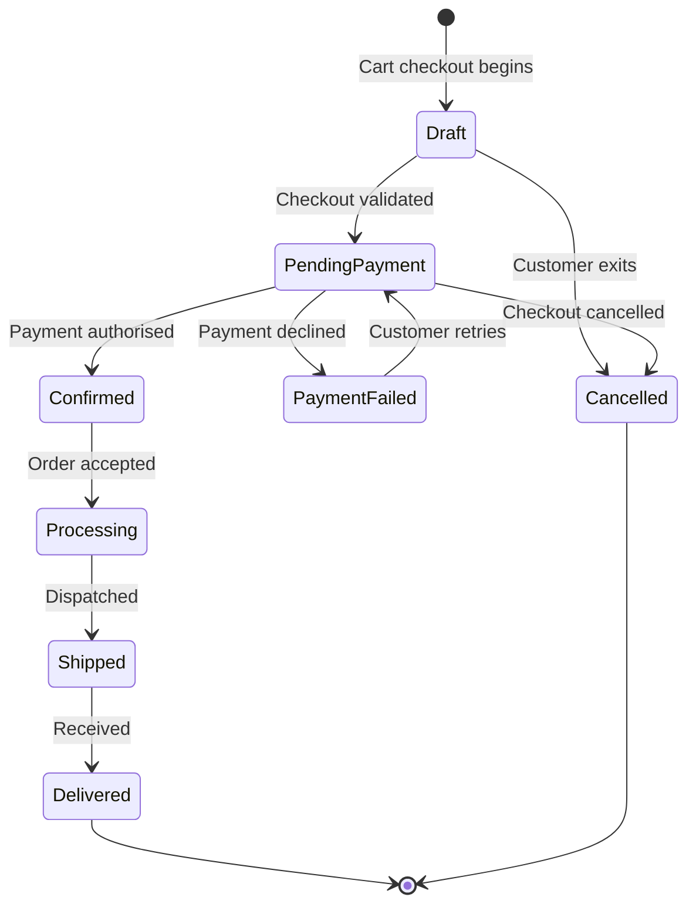
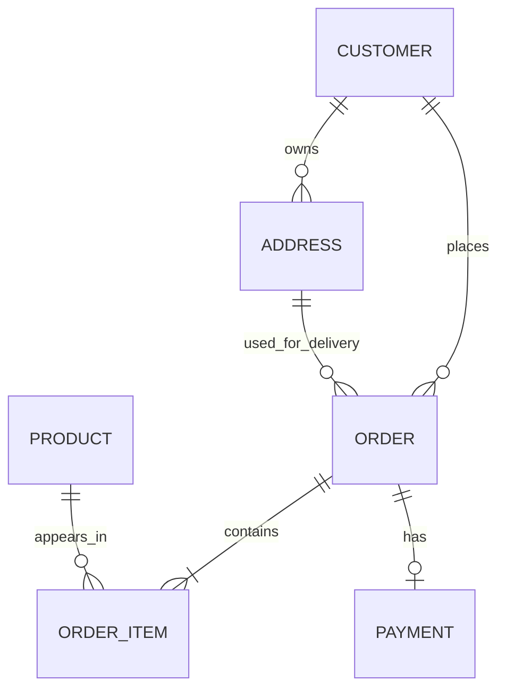

# ShopKart — Checkout and Orders

> College end-term project module for modelling and implementing a reliable e-commerce checkout and order-management workflow.

## Abstract

ShopKart — Checkout and Orders models the part of an e-commerce system that transforms a customer's cart into a confirmed order. It captures delivery details, validates the request, records payment status, persists the order, and supports later order tracking.

The project demonstrates full-stack system design, input validation, data modelling, transactional workflows, and secure configuration management. Its design separates user-facing screens, business rules, persistence, and external integrations so that each part can be tested independently.

## Objectives

- Implement a structured checkout flow from cart review to order confirmation.
- Validate items, stock, addresses, order totals, and payment input.
- Maintain clear order lifecycle states and auditable data.
- Apply server-side validation and transaction boundaries to avoid inconsistent orders.
- Follow safe source-control practices for credentials and generated files.

## System Architecture

The system uses a layered architecture: the interface calls application endpoints; endpoints delegate decisions to services; services use repositories for persistence and adapters for outside systems.



| Layer | Responsibility |
| --- | --- |
| Presentation | Collects input and displays cart, checkout, payment, and order-status screens. |
| API / Controller | Accepts requests, checks request shape/authentication, and returns responses. |
| Service | Applies checkout rules, calculates totals, changes order state, and coordinates transactions. |
| Repository | Reads and writes domain data without embedding business rules in data queries. |
| External adapter | Isolates payment, inventory, and notification providers from core logic. |

## Intended Repository Structure



```text
.
├── src/
│   ├── controllers/      # Request handlers / API routes
│   ├── services/         # Checkout and order business rules
│   ├── models/           # Domain entities and DTOs
│   ├── repositories/     # Database access
│   └── integrations/     # Payment and notification adapters
├── tests/                # Unit and integration tests
├── docs/                 # Report material and design notes
├── .env.example          # Non-secret configuration template (optional)
└── README.md
```

## Checkout Workflow



## Order Lifecycle



## Core Data Model



## API Design (Conceptual)

| Method | Endpoint | Purpose |
| --- | --- | --- |
| `POST` | `/checkout/validate` | Validates cart, address, totals, and checkout eligibility. |
| `POST` | `/orders` | Creates an order after successful checkout/payment processing. |
| `GET` | `/orders/{orderId}` | Retrieves an order and its current status. |
| `GET` | `/orders` | Retrieves the authenticated customer's order history. |
| `POST` | `/payments/confirm` | Records the payment-processing result. |
| `PATCH` | `/orders/{orderId}/status` | Changes order status for authorised workflows. |

Example checkout request:

```json
{
  "cartId": "cart_123",
  "deliveryAddressId": "addr_456",
  "paymentMethod": "sandbox_card"
}
```

## Validation, Reliability, and Security

- Validate all fields on the server even when client-side validation exists.
- Recalculate prices from trusted product data; never trust a total sent by the client.
- Check availability before authorising payment or creating an order.
- Use a transaction for related writes such as orders, order items, and payment state.
- Make payment confirmation idempotent to prevent duplicate orders on retries.
- Return non-sensitive error messages and log useful diagnostic context.

## Testing Strategy

| Test type | Example scope |
| --- | --- |
| Unit | Total calculation, status transitions, validation and discount rules. |
| Integration | Repository queries, transaction handling, payment-adapter responses. |
| API | Checkout success/failure, authorisation and malformed-input handling. |
| Manual | Checkout UI, responsive layout, sandbox payment, and error messages. |

## Future Enhancements

- Coupon and promotion support.
- Shipment tracking, refunds, and returns.
- Inventory reservation to reduce overselling.
- Role-based admin dashboard and analytics.
- Event-driven notifications and order-status updates.

## Before you begin

Inspect the package/build manifest in the repository root first (for example, `package.json`, `pom.xml`, `build.gradle`, or `requirements.txt`). Install the matching runtime and package manager before installing dependencies.

## Setup

1. Clone the repository:

   ```bash
   git clone <repository-url>
   cd "ShopKart-BEL - Checkout and orders"
   ```

2. Install dependencies using the package manager declared by the project. Typical examples:

   ```bash
   npm ci              # Node.js projects with package-lock.json
   pnpm install --frozen-lockfile
   yarn install --immutable
   ```

   Use only the command that matches the committed manifest/lockfile; do not create a new lockfile just to start the project.

3. Create your local environment file from the committed example, if one is provided:

   ```bash
   # macOS / Linux
   cp .env.example .env

   # PowerShell
   Copy-Item .env.example .env
   ```

4. Populate `.env` only with values for your local environment. Never commit this file.

5. Start the application using the repository’s development command.

## Environment and secret safety

Do not commit API keys, credentials, tokens, private certificates, or local `.env` files. The repository’s `.gitignore` should exclude `.env` and its local variants while allowing an intentionally non-sensitive `.env.example` template.

Before committing or pushing, run:

```bash
git status
git diff --cached
```

In PowerShell, check for accidentally tracked environment files and private-key material with:

```powershell
git ls-files | Select-String -Pattern '(^|/)(\.env($|\.)|.*\.(pem|key|p12|pfx)$)'
```

If a secret was accidentally staged, remove it from the index without deleting your local copy:

```bash
git restore --staged <file>
```

If it was already committed or pushed, rotate the credential immediately, remove it from Git history, and notify anyone with access to the repository.

## Useful commands

Use the package scripts or build files committed in this repository for the following actions:

- Development server
- Production build
- Test suite
- Linting / formatting

For a Node.js service, these are commonly exposed as `npm run dev`, `npm test`, `npm run lint`, and `npm run build`; use the actual scripts declared in `package.json`. Keep this README updated when the setup flow changes.

## Contributing

Keep changes focused, run the relevant checks before opening a pull request, and never include secrets in source code, logs, screenshots, test fixtures, or documentation.
