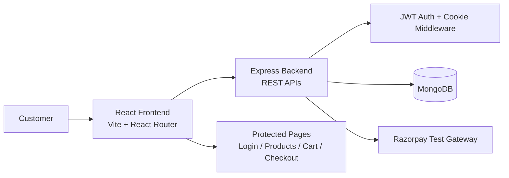
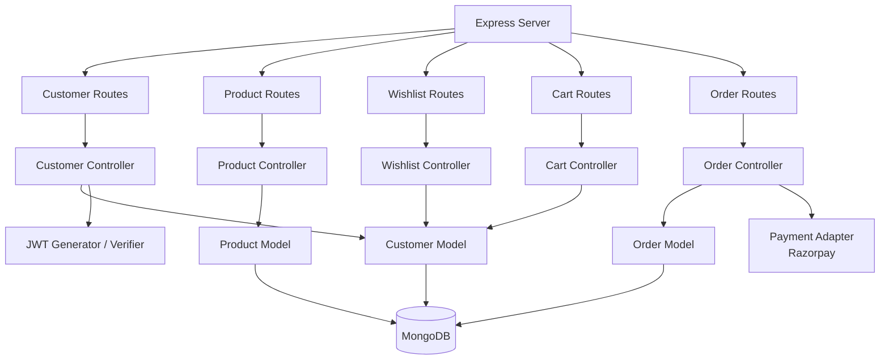
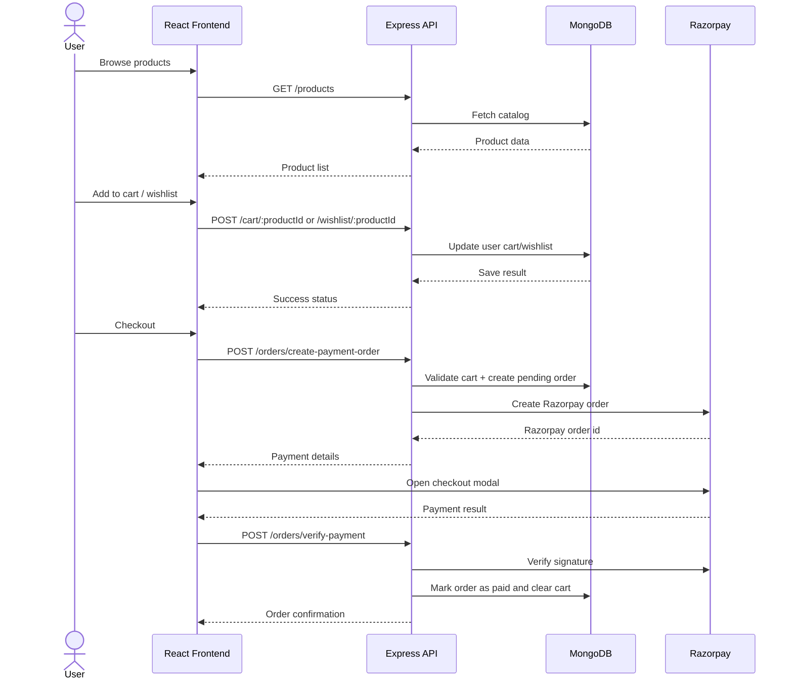

# ShopKart — Full Stack E-Commerce Project (Labs 01 to 06)

This repository contains the complete implementation of the ShopKart full-stack project across six engineering labs. The project progresses from a backend authentication service to a complete product catalog, wishlist, cart, checkout, payment verification, and order tracking experience.

The README below consolidates the work implemented in Lab 01 through Lab 06 and documents the architecture, user flows, API contracts, and project setup.

---

## 1. Project Overview

ShopKart is a full-stack e-commerce application built with Node.js, Express.js, MongoDB, and React. The system allows customers to:

- register and log in securely
- browse and search product catalogues
- save products to a wishlist
- manage a shopping cart
- complete a checkout flow with Razorpay test payment
- view and track past orders

The project follows an MVC-style backend and a component-based React frontend. Authentication is handled using JWT stored in an HttpOnly cookie, and protected routes are enforced on the server.

### High-Level Architecture



### Backend Architecture



### Customer Purchase Journey



---

## 2. Tech Stack

### Backend
- Node.js
- Express.js
- MongoDB + Mongoose
- bcrypt
- jsonwebtoken
- cookie-parser
- Razorpay SDK

### Frontend
- React
- Vite
- React Router DOM
- Axios
- CSS

### Tools
- Postman / API testing
- MongoDB Atlas / local MongoDB
- VS Code / Git

---

## 3. Application Flow by Lab

### Lab 01 — Customer Authentication Service

This lab focused on the backend authentication core of the application.

#### Features implemented
- Customer registration API
- Customer login API
- JWT generation
- HttpOnly cookie-based authentication
- Protected profile endpoint
- Secure logout
- Password hashing with bcrypt

#### Customer schema
- fullName
- email
- password
- phone
- createdAt
- wishlist
- cart

#### API endpoints
| Method | Endpoint | Description |
| --- | --- | --- |
| POST | /customers/register | Create a new customer account |
| POST | /customers/login | Authenticate user and set the JWT cookie |
| GET | /customers/me | Get the authenticated customer's profile |
| POST | /customers/logout | Clear the auth cookie |
| PATCH | /customers/change-password | Change password for authenticated user |

#### Key backend notes
- Passwords are never stored in plaintext.
- Email uniqueness is enforced.
- JWT is validated via the `protect` middleware.
- `req.user` is attached to authenticated requests.

---

### Lab 02 — Frontend Login → Home Flow

This lab added the user-facing authentication flow on the frontend.

#### Pages created
- Register page
- Login page
- Home page
- Navbar

#### Features implemented
- Controlled form inputs
- Validation on login/register
- Redirect after successful login/register
- Protected access to post-login pages
- Logout button in navbar
- Cookies sent automatically with Axios requests

#### Frontend routes
| Route | Purpose |
| --- | --- |
| /register | Customer registration page |
| /login | Customer login page |
| /home | Authenticated landing page |

#### Implementation approach
- Axios is configured with `withCredentials: true`
- `react-router-dom` handles front-end navigation
- API logic is separated into `frontend/src/services/api.js`

---

### Lab 03 — Product Catalog & Discovery

This lab introduced the product catalogue and browsing experience.

#### Features implemented
- Product model with validations
- Product creation API
- Product listing API
- Product details API
- Search by product name
- Category-based filtering
- Sorting support
- Loading and empty states on the front-end

#### Product schema
- name
- description
- price
- category
- image
- stock
- createdAt

#### Product API endpoints
| Method | Endpoint | Description |
| --- | --- | --- |
| POST | /products | Create a product |
| GET | /products | Fetch all products with optional query filters |
| GET | /products/:id | Fetch single product by ID |

#### Supported query filters
- `?search=keyboard`
- `?category=Electronics`
- `?search=keyboard&category=Electronics`
- `?sort=price_asc`
- `?sort=price_desc`

#### Frontend pages
- `Products.jsx`
- `ProductDetails.jsx`
- `SearchBar.jsx`
- `ProductCard.jsx`

---

### Lab 04 — Wishlist System

This lab created a persistent wishlist tied to the authenticated customer.

#### Core idea
A wishlist stores product references in the customer document instead of duplicating product data.

#### Wishlist features
- Add product to wishlist
- Prevent duplicate wishlist entries
- View all saved products
- Remove a product from wishlist
- Protected wishlist routes
- Populate product data in the response

#### Wishlist API endpoints
| Method | Endpoint | Description |
| --- | --- | --- |
| POST | /wishlist/:productId | Add product to wishlist |
| GET | /wishlist | Get current user wishlist |
| DELETE | /wishlist/:productId | Remove product from wishlist |

#### Wishlist data model
```js
wishlist: [
  { type: mongoose.Schema.Types.ObjectId, ref: 'Product' }
]
```

---

### Lab 05 — Shopping Cart

This lab added the cart system and connected it to user data and product stock.

#### Features implemented
- Cart stored per user
- Product quantity tracking
- Duplicate product line handling
- Add product to cart
- Increase/decrease quantity
- Remove product from cart
- Recalculate subtotal and cart item count
- Stock validation before updates
- Persistent cart loading from the backend

#### Cart data model
```js
cart: [
  {
    product: { type: mongoose.Schema.Types.ObjectId, ref: 'Product' },
    quantity: { type: Number, default: 1, min: 1 }
  }
]
```

#### Cart API endpoints
| Method | Endpoint | Description |
| --- | --- | --- |
| POST | /cart/:productId | Add a product to the cart |
| GET | /cart | Get the authenticated user's cart |
| PATCH | /cart/:productId | Update quantity |
| DELETE | /cart/:productId | Remove product from the cart |

#### Frontend behavior implemented
- cart is managed with global context
- cart badge/quantity count is displayed in the navbar
- cart page shows product details, quantity controls, and summary
- checkout entry is prepared from the cart state

---

### Lab 06 — Checkout and Orders

This lab completed the purchase journey and added the final checkout flow.

#### Features implemented
- Shipping address form
- Final cart review before checkout
- Server-side validation of cart and address details
- Order creation with stored product snapshots
- Razorpay test payment integration
- Payment signature verification
- Order confirmation flow
- Order history page
- Protected order details routes
- Resume payment for pending orders using the existing Razorpay order
- Cart cleared only after successful payment verification

#### Order schema
- user
- items[]
- shippingAddress
- totalAmount
- paymentStatus
- status
- razorpayOrderId
- razorpayPaymentId
- timestamps

#### Order API endpoints
| Method | Endpoint | Description |
| --- | --- | --- |
| POST | /orders/create-payment-order | Validate cart, create pending ShopKart order, and create Razorpay order |
| POST | /orders/verify-payment | Verify signature and confirm the order |
| GET | /orders | Get current customer's orders |
| GET | /orders/:id | Fetch single order by ID |
| GET | /orders/:id/payment-session | Get the existing payment session for an owned pending order |
| PATCH | /orders/:id/status | Update order fulfilment status |

#### Payment flow
1. Customer reviews cart and enters shipping details
2. Server validates cart and address
3. ShopKart order is created in `PENDING_PAYMENT`
4. Razorpay order is created on the backend
5. Frontend opens Razorpay Checkout
6. Signature is verified on the server
7. Order is marked as `PAID`
8. Cart is cleared
9. User is redirected to success / confirmation page

If checkout is closed or payment fails, the order remains `PENDING_PAYMENT`. The customer can continue from My Orders or the order details page. Resuming uses the saved order amount and existing Razorpay order ID; it does not create another ShopKart order. A payment is only marked successful after server-side signature verification.

#### Razorpay test payment details

Use these details only with Razorpay **test mode** credentials (`RAZORPAY_KEY_ID` should start with `rzp_test_`). These are simulated payments; no real money is charged.

- **Card number:** `4100 2800 0000 1007`
- **Expiry:** any future date
- **CVV:** any random 3-digit value
- **OTP, if prompted:** enter any random 4–10 digit number to simulate a successful payment

Do not enter real card details or use live Razorpay keys when testing.

---

## 4. Frontend Pages and Screens

The frontend contains the pages and components required for the full customer journey:

- `Login.jsx`
- `Register.jsx`
- `Home.jsx`
- `Products.jsx`
- `ProductDetails.jsx`
- `Wishlist.jsx`
- `Cart.jsx`
- `Checkout.jsx`
- `OrderSuccess.jsx`
- `Orders.jsx`
- `OrderDetails.jsx`

Additional reusable UI components:
- `Navbar.jsx`
- `ProductCard.jsx`
- `SearchBar.jsx`
- `OrderCard.jsx`
- `OrderSummary.jsx`
- `CheckoutForm.jsx`

Global state:
- `CartContext.jsx`

---

## 5. Backend Architecture

```text
backend/
├── config/
│   └── razorpay.js
├── controllers/
│   ├── cart.controller.js
│   ├── customer.controller.js
│   ├── order.controller.js
│   ├── product.controller.js
│   └── wishlist.controller.js
├── middlewares/
│   └── auth.middleware.js
├── models/
│   ├── customer.model.js
│   ├── order.model.js
│   └── product.model.js
├── routes/
│   ├── cart.routes.js
│   ├── customer.routes.js
│   ├── order.routes.js
│   ├── product.routes.js
│   └── wishlist.routes.js
├── seed/
│   └── products.seed.js
├── utils/
│   └── generateToken.js
├── index.js
├── package.json
└── .env
```

### Middleware and security
- JWT is read from the `token` cookie
- `protect` middleware verifies the token and attaches `req.user`
- protected endpoints guard user-specific data
- server-side validation checks business rules even when client validation exists

---

## 6. Frontend Structure

```text
frontend/
├── public/
├── src/
│   ├── assets/
│   ├── components/
│   ├── context/
│   ├── pages/
│   ├── services/
│   ├── utils/
│   ├── App.jsx
│   ├── index.css
│   └── main.jsx
├── index.html
├── package.json
├── vite.config.js
└── README.md
```

---

## 7. API Summary

| Module | Endpoint(s) | Auth |
| --- | --- | --- |
| Customers | /customers/register, /customers/login, /customers/me, /customers/logout | Yes for protected routes |
| Products | /products, /products/:id | No |
| Wishlist | /wishlist, /wishlist/:productId | Yes |
| Cart | /cart, /cart/:productId | Yes |
| Orders | /orders, /orders/:id, /orders/create-payment-order, /orders/verify-payment | Yes |

---

## 8. Environment Setup

### Backend `.env` example
```env
PORT=3000
MONGO_URI=mongodb://localhost:27017/shopkart
JWT_SECRET=your_jwt_secret
NODE_ENV=development
RAZORPAY_KEY_ID=your_test_key_id
RAZORPAY_KEY_SECRET=your_test_key_secret
# Production: comma-separated exact frontend origins, e.g. https://shopkart.vercel.app
CORS_ORIGINS=http://localhost:5173
```

### Install dependencies
```bash
cd backend
npm install

cd ../frontend
npm install
```

### Run the app
```bash
# Backend
cd backend
npm run dev

# Frontend
cd frontend
npm run dev
```

The backend runs on `http://localhost:3000` and the frontend runs on `http://localhost:5173` by default.

### Production deployment notes

- Set `CORS_ORIGINS` on the backend to the exact deployed frontend origin (scheme and host, no trailing path). Multiple origins can be comma-separated. Localhost origins are allowed automatically when `NODE_ENV` is not `production`.
- Set `VITE_API_URL` in the frontend host to the deployed backend URL, for example `https://shopkart-bel.onrender.com`.
- In production, the authentication cookie uses `SameSite=None; Secure` for cross-origin frontend/API requests. Locally it uses `SameSite=Lax` without requiring HTTPS. Login and logout share the same cookie attributes.
- Use HTTPS for both deployed sites. Some browsers restrict third-party cookies across unrelated hosting domains; custom frontend and API subdomains under the same parent domain are more reliable if the browser blocks the cookie.

---

## 9. Project Outcome

By the end of Labs 01–06, the project implements a functioning e-commerce journey:

- user registration and secure login
- authenticated profile access
- product discovery and filtering
- wishlist persistence
- cart management with stock validation
- checkout and shipping form
- Razorpay-based payment flow
- order creation and order history

This makes ShopKart a complete full-stack mini e-commerce application that demonstrates backend design, secure authentication, data modelling, state management, and payment integration.

---

## 10. Repository Notes

The project is built as a learning-focused full-stack assignment and is organized to reflect a production-inspired structure:

- backend handles business logic, persistence, auth, and rules
- frontend renders the customer interface and user journeys
- MongoDB stores customers, products, cart entries, wishlist references, and orders
- Razorpay is used only in test mode for safe learning and payment simulation

---

## 11. Completion Status

Implemented across labs:
- [x] Lab 01 — Authentication Service
- [x] Lab 02 — Login / Register / Home Flow
- [x] Lab 03 — Product Catalog
- [x] Lab 04 — Wishlist System
- [x] Lab 05 — Shopping Cart
- [x] Lab 06 — Checkout and Orders

This repository is ready to serve as a consolidated ShopKart project documentation and implementation reference.
